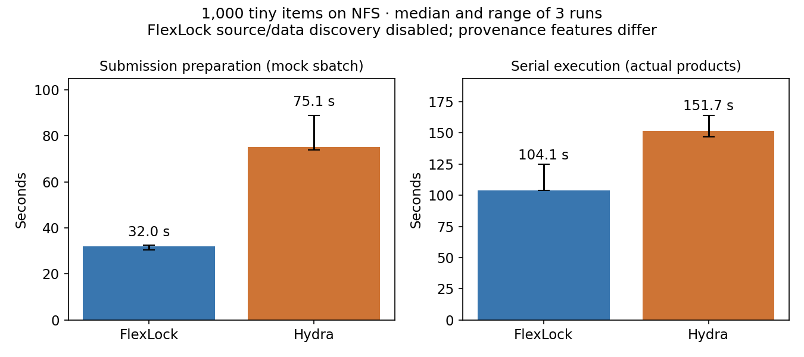

# Thousand-item FlexLock / Hydra comparison

The measurements support a smaller FlexLock core, but expose substantial work
inside that core. FlexLock's reduced-provenance baseline was faster than native
Hydra here. Source tracking made FlexLock substantially slower, and optional
legacy cache discovery introduced repeated directory scans. Removing pipeline
policy alone will not solve the original file-listing performance problem.

## Results

All 56 fresh-process cases completed successfully. The primary matrix contains
100 and 1,000 items, seven variants and three repeats (42 cases). Supplemental
cases isolate provenance, cache lookup, claim batching and profiling.

| 1,000-item operation, NFS | FlexLock seconds | Hydra seconds | Evidence |
|---|---:|---:|---|
| Serial local execution, reduced FlexLock provenance | 104.13 (104.09–124.76) | 151.73 (146.64–164.17) | Median and range, three repeats |
| Slurm payload preparation, mocked submission | 32.04 (30.52–32.50) | 75.08 (73.86–88.97) | Median and range, three repeats |
| Local execution with explicit source and per-item input tracking | 452.38 | — | One sample; native Hydra has no equivalent tracking added |
| Local execution, claim batch 16, reduced provenance | 91.01 | — | One sample |
| Source-aware Slurm preparation | 36.27 | — | One sample; workers never execute |
| Cache misses with default legacy fallback | 495.49 | — | One sample; fresh empty index |
| Cache misses, index-only (`FLEXLOCK_INDEX_FALLBACK=0`) | 31.78 | — | One sample; same workload |

The local baselines perform the same actual work: read a 4 KiB fixture, hash it,
write `product.json`. FlexLock still records configurations, task outcomes and
destination ownership; automatic repository discovery and declared data tracking
are disabled in the baseline. This is a comparison of native execution paths,
not a comparison of equivalent provenance features. The tracked sample records
the benchmark repository, scopes its fingerprint to `benchmarks`, and hashes each
item's declared input. It does not demonstrate complete scientific dependency
tracking or a general 452-second cost for every campaign.

Exportable [SVG](primary-comparison.svg), [component chart](cost-components.png)
and [component SVG](cost-components.svg) accompany the measurements.

## Configuration and queue work

For 1,000 distinct configurations, phase medians were:

| Phase | Seconds |
|---|---:|
| `py2cfg` creation, already returning OmegaConf nodes | 2.229 |
| `hydra_zen.builds(populate_full_signature=True)` | 0.655 |
| Deferred `ZenStore` insertion | 0.003 |
| Materialize those entries into Hydra's ConfigStore | 3.241 |
| Additional OmegaConf copies of the FlexLock nodes | 1.665 |

The last phase is additional copying, not necessary initial `py2cfg` creation.
Dataclass generation and fully materialized nodes are different operations.
Do not compare the total mixed configuration case against either framework's
execution time or count its phases as independent end-to-end workloads.

Crucially, the actual Hydra launcher cases register **one reusable config** and
sweep item overrides. They do not register 1,000 configs. Your historical
per-item registration pattern is supported, but its cost is not mandatory for
file-list processing. [ZenStore documents deferred creation and registration](https://mit-ll-responsible-ai.github.io/hydra-zen/generated/hydra_zen.ZenStore.html).
This benchmark does not assess hydra-zen typing/composability problems or either
library's learning curve.

Queue insertion alone took a median 0.59–0.67 seconds. Insert plus claim/finish
took 20.74 seconds with batch 1 and 5.72 seconds with batch 16 on NFS. The ext4
single samples were 6.96 and 4.31 seconds respectively. Queue-only cases execute
no user function or provenance capture. Complete batch-16 execution improved
by about 13% against the baseline median, much less than the queue-only gain;
that observation is one sample, not a new default recommendation. Larger claims
also distribute outstanding work in larger units; load balancing and recovery
under multiple workers were not measured.

## Provenance and cache costs

The isolated identity case measured:

| Component | Seconds | Scope |
|---|---:|---|
| Bind producer record | 3.945 | 1,000 bindings to one concrete existing record |
| Verify and resolve bound record | 2.220 | 1,000 verifications |
| Full directory identity | 0.834 | 1,000 paths and all 4,096,000 input bytes |
| Individual uncached file identities | 0.716 | 1,000 files |
| Source fingerprint | 105.598 | 1,000 calls, same config and benchmark scope |
| Source snapshot | 0.171 | One call |

These components do not add up to the tracked execution overhead: they have
different call paths and omit worker drift checks. A separate 100-item tracked
profile found 24.53 seconds in `code_drift` and 12.80 seconds in `fingerprint`.
There were 66,716 `Path.resolve` calls and 1,340,420 `lstat` calls in that
profile. Drift detection enumerates loaded Python modules and resolves their
paths for every item, including modules outside the tracked repository. It is
a significant additional cost, not just Git hashing. Profile times include
instrumentation overhead and are excluded from primary medians.

For optional cache search, a 100-item profile recorded 100 fallback scans and
20,200 `scandir` calls. The sweep has already created destination directories
for its guards. Each index miss recursively traverses that shared scope twice
through `iter_run_dirs`. Repeated per-item fallback therefore grows with both
item count and directory count. The 1,000-item index-only experiment removes
the large increase, supporting this explanation without claiming exact causal
subtraction across separate timings. Index-only lookup deliberately cannot find
unindexed historical runs. It is a diagnostic and explicit policy option,
not a transparent replacement for compatibility discovery.

Baseline profiles also reveal configuration duplication: 1,003 OmegaConf
creation calls for FlexLock's 100 local items, and 504 for submission preparation.
Hydra's local profile composed 200 sweep configs for 100 items, from validation
and launch. Both frameworks pay for repeated configuration work.

## Scheduler and artifact comparison

Both scheduler paths made **one mocked `sbatch` call**. Hydra Submitit already
supports Slurm arrays and concurrency limits; the generated script contains
`--array=0-999%4`. FlexLock submits `--array=0-3`: four worker elements claiming
1,000 queue items. Hydra uses one serialized payload per array item; FlexLock
uses one worker payload plus a shared database. [Hydra Submitit documentation](https://hydra.cc/docs/1.3/plugins/submitit_launcher/).

| Preparation artifacts, median | FlexLock | Hydra Submitit |
|---|---:|---:|
| Files | 2,007 | 1,003 |
| Logical file bytes, decimal MB | 0.91 | 48.32 |
| Pickled payloads | 1 | 1,000 |
| Array elements | 4 | 1,000, maximum 4 concurrent |

FlexLock has more small files because it creates controller lock files and queue
ownership pointers for every destination before submission. These guards protect
against replacing pending provenance. Changing `task_record` to `db` left the
preparation file count unchanged. Local baseline counts were 7,005 for FlexLock
and 4,001 for Hydra; retained provenance and receipts account for additional work.
Counts precede `measurement.json` and treat file symlinks as files; bytes are a
logical census, not physical disk usage.

Fixed worker count can help where array-size or site job-count limits matter.
A concurrency cap does not reduce an array's element count. However, this test
does not measure those site limits, Slurm congestion or parallel throughput.
Hydra composes a sweep config again on its worker; FlexLock freezes queue configs
and guards their destinations on the controller. These are different lifecycle
contracts. [Hydra's multirun documentation describes serial BasicLauncher execution and lazy composition](https://hydra.cc/docs/1.3/tutorials/basic/running_your_app/multi-run/).

## Consequences for the slimmer core

Keep the chosen direction: Python configuration, stable concrete artifact reads,
source/data/lineage records, truthful execution outcomes and a bounded worker
queue. The retained `${run_lock:...}` pattern has a modest measured binding cost.
Hydra can also start from Python configs, as this harness demonstrates through
ConfigStore; FlexLock's distinction is its smaller usage surface plus provenance
and artifact binding, rather than Python config capability alone.

Prioritize three measured improvements before claiming scalable tiny-item use:

1. Reduce repeated module-path resolution and source fingerprint work while
   preserving lazy-import/change detection. Sharing source evidence needs an
   explicit, verified frozen-source contract; no blind mtime-only or process
   cache should weaken provenance.
2. Reduce repeated OmegaConf construction after effective overrides are frozen,
   retaining root interpolation and pre-dispatch binding semantics.
3. Keep broad cache discovery optional. If compatibility lookup remains, batch
   its scoped candidate inventory instead of recursively searching once per item.

For current large fresh campaigns, explicitly use `smart_run=False` in Python
and inspect claim batch sizes against task duration and worker count. Preserve
destination guards even when reducing metadata overhead. Cohort completeness
remains an explicit project check; no benchmark result justifies a DAG compiler,
automatic stage equivalence or silently selecting a different artifact.

This completes the bounded M4 performance measurement. Runtime defaults and
public APIs are unchanged. Optimization, multi-worker validation and isolated
consumer replacement/adoption remain separate work.

## Reproduction and evidence

- Frozen source: `9ab83a30ec977d6d63d5945e803b15e6951d3464`, branch
  `workflow/execution-acceptance`. All cases report this revision.
- Harness: [measure.py](../../benchmarks/thousand_items/measure.py),
  [matrix.py](../../benchmarks/thousand_items/matrix.py),
  [task.py](../../benchmarks/thousand_items/task.py).
- Interpreter: `/ontap/user/qfebvre/work/projects/251218_sst/sst_ml_zarrpatch/.pixi/envs/cpu/bin/python`.
  Extra dependencies live in `/ontap/user/qfebvre/flexlock-benchmark-deps`;
  the shared environment was not modified.
- Hydra 1.3.2, hydra-zen 0.16.0, Hydra Submitit launcher 1.2.0, Submitit 1.5.4,
  OmegaConf 2.3.1. Exact commands, host, starting load averages, versions and
  measurements: [primary](nfs-primary-measurements.json),
  [supplement](supplement-measurements.json).
- [Summary CSV](summary.csv), [summary JSON](summary.json),
  [artifact validation](validation.json), [source evidence](source-evidence.json)
  and [profiles](profiles.json) are retained in this report.
- Original manifests and all run artifacts remain under
  `/ontap/user/qfebvre/flexlock-hydra-benchmark/nfs-primary` and `supplement`.
  ext4 cases remain under `/tmp/flexlock-hydra-benchmark`.

Measurements are sequential fresh processes on `compute-118-39`, with one local
worker/serial launcher and 1,000 deterministic 4 KiB fixtures. The main output
filesystem is NFS4; only queue components were also measured on ext4. Variant
order rotates between primary repeats; there is no cold-cache guarantee.
Imports and initial config construction occur before the timer; process durations
including startup are retained separately. Both libraries are imported in every
case, so the loaded-module inventory is specific to this harness. Peak RSS is
the Python process's peak, not aggregate child-process memory. Logs are disabled
for Hydra and FlexLock worker startup staggering is patched away. The task has
no intentional sleeps; the patch does not represent cluster startup behavior.

Scheduler commands are intercepted, and any unmocked scheduler subprocess is
rejected. Submitit's result retrieval is also stubbed to let preparation return.
No scheduler case ran workers or produced products. Local product membership and
SHA-256 values are checked against the exact inputs. No real jobs, scientific
data or installed production FlexLock were changed. These are benchmark checks,
not a new full-suite compatibility or scientific adoption claim.
